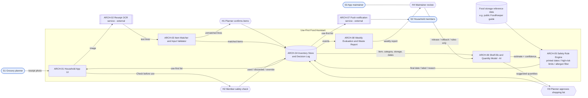

# 05 – Lightweight System Architecture

## Diagram

## Components

| ID | Component | Responsibility | Key data in / out |
|---|---|---|---|
| ARCH-01 | Household App UI | Inventory view, use-first list, "Check before use" labels, 2-tap used/discarded logging, shopping approval | In: lists from ARCH-04. Out: confirmations, overrides |
| ARCH-02 | Receipt OCR service (external) | Converts receipt photo to text lines | In: photo. Out: text lines (photo deleted after extraction) |
| ARCH-03 | Item Matcher and Input Validator | Maps receipt lines to food categories; rejects or queues unknown lines; enforces data contract (category, storage, purchase date required) | Out: matched items; "Needs label" list |
| ARCH-04 | Inventory Store and Decision Log | Items, dates, status; every recommendation with model version, every human decision and override | Household-only access; no images stored |
| ARCH-05 | Safety Rule Engine (non-AI) | Printed date always wins; fixed conservative limits for high-risk foods; allergen filter for recipes; rules-only mode per category | Has the final word over ARCH-06 |
| ARCH-06 | Shelf-life and Quantity Model (AI) | Estimates days left for undated items and weekly quantity per item, with confidence | Trained on household's own used/discarded log; versioned, seeded |
| ARCH-07 | Push notification service (external) | Sends 8:00 pm reminder; retries; app banner fallback | Out: notification |
| ARCH-08 | Weekly Evaluation and Waste Report | Per-category error, "spoiled early" rate, waste trend vs baseline; triggers rules-only switch | Out: report to maintainer and planner |

## Human oversight points

| ID | Where | Who | What they decide |
|---|---|---|---|
| H1 | After receipt scan | S1 Planner | Confirm or correct extracted items; label unmatched lines |
| H2 | Before eating an item marked "Check before use" | S2 Member | Use, discard or override the estimate |
| H3 | Weekly shopping suggestion | S1 Planner | Approve or edit quantities – nothing is bought automatically |
| H4 | Weekly evaluation report | S3 Maintainer | Release, roll back, or keep a category in rules-only mode |

## Design rationale

1. **Rules guard the AI (ARCH-05 after ARCH-06).** Food safety cannot depend on a probabilistic estimate, so the deterministic rule engine always has the final word and the AI is used only where the non-AI option fails (undated items, quantities). This also gives a ready fallback: if ARCH-06 is down or switched off, the app still works as the non-AI FIFO list.
2. **Recommend-and-confirm.** Every decision with consequences (what enters the inventory, what is bought, what is eaten) passes a human oversight point (H1–H3), matching the decision authority in the stakeholder map.
3. **Privacy by minimisation.** The external OCR service receives only the photo, which is deleted after extraction; the household data stays in ARCH-04.
4. **Learning loop with a stop switch.** Used/discarded events feed ARCH-08, which measures real errors and can switch a category to rules-only automatically, keeping the maintainer accountable (H4).
5. **Kept small.** One app, one store, one model; external services are used for OCR and notifications instead of building them.
